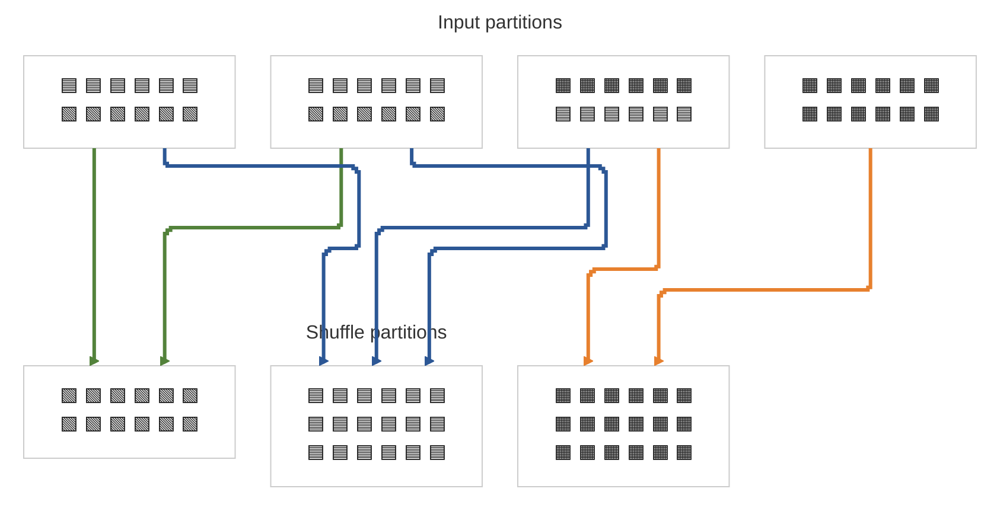

# Aggregations & Grouping
```scala mdoc:invisible
import org.apache.spark.sql.SparkSession
import org.apache.spark.sql.functions._

import common._

val spark = SparkSession.builder()
    .appName("Aggregations and Grouping")
    .getOrCreateLocal()

import spark.implicits._
```
```scala mdoc
val moviesDF = spark.read
  .option("inferSchema", "true")
  .json("path/to/movies.json")
```

## Aggregations

### `count` (Count)
```scala mdoc
moviesDF.select(count($"Major_Genre")).show()
```

### Count All
```scala mdoc
moviesDF.select(count("*")).show()
```
moviesDF.selectExpr("count(*)").show()

### `count_distinct` (Count Distinct)
```scala mdoc
moviesDF.select(count_distinct($"Major_Genre")).show()
```

### `approx_count_distinct` (Approximate Count)
```scala mdoc
moviesDF.select(approx_count_distinct($"Major_Genre")).show()
```

### `min` & `max`
```scala mdoc
moviesDF.select(min($"IMDB_Rating")).show()
moviesDF.selectExpr("min(IMDB_Rating)").show()
```

### `sum`
```scala mdoc
moviesDF.select(sum($"US_Gross")).show()
moviesDF.selectExpr("sum(US_Gross)").show()
```

### `avg` (Average)
```scala mdoc
moviesDF.select(avg($"Rotten_Tomatoes_Rating")).show()
moviesDF.selectExpr("avg(Rotten_Tomatoes_Rating)").show()
```

### Data Science e.g. Std. Deviation
```scala mdoc
moviesDF.select(
  mean($"Rotten_Tomatoes_Rating"),
  stddev($"Rotten_Tomatoes_Rating")
).show()
```

## Grouping

### `groupBy`
```sql
select count(*) from moviesDF group by Major_Genre
```

```scala mdoc
moviesDF
  .groupBy($"Major_Genre")
  .count()
  .show()
```

### `avg`

There are aggregation overloads e.g. `avg` that take `String` column names:
```scala mdoc
moviesDF
  .groupBy($"Major_Genre")
  .avg("IMDB_Rating")
  .show()
```

### `agg`
Multiple aggregations can be specified on a group together using `agg`:

```scala mdoc
moviesDF
  .groupBy($"Major_Genre")
  .agg(
    "Movies" := count("*"),
    "Avg Rating" := avg("IMDB_Rating")
  )
  .orderBy($"Avg Rating")
  .show()
```

## Wide Transformations

### One or more input partitions => One or more output partitions
Starting with 4 input-partitions, containing 8 datums , `groupBy` will shuffle them, possibly into
a different assignment of partitions, e.g. the same 8 datums, but across 3 partitions:
